# DevTinder - Developer Connection Platform

## 🚀 Overview

**DevTinder** is a full-stack social networking platform for developers to connect, collaborate, and network. Think of it as "Tinder for Developers." Users swipe through profiles, send connection requests, chat in real time, and upgrade to premium memberships.

The backend is a **horizontally scaled monolith**: multiple Node.js instances run behind an **Nginx load balancer** and coordinate through **Redis** (shared sessions + Pub/Sub presence), **gRPC** (cross-server message routing), and **Apache Kafka** (durable chat delivery). Media is stored on **AWS S3** and payments run on **Razorpay**.

**🔗 Live Demo:** [https://devtinder.iambuzzdev.in/](https://devtinder.iambuzzdev.in/)

---

## 📸 App Screenshots

| **1. Home Screen** | **2. Login** |
| :---: | :---: |
| 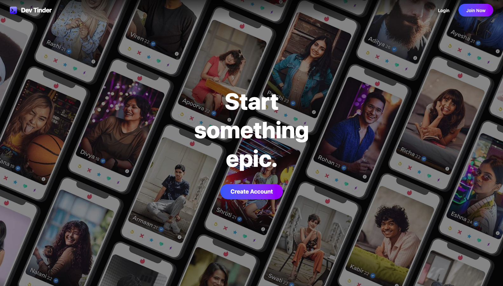 | 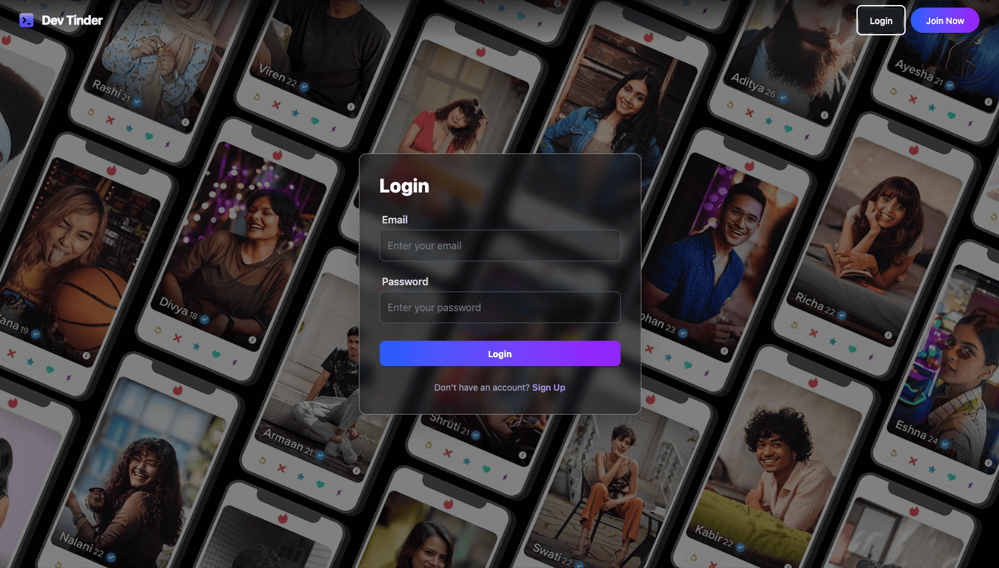 |
| **3. Signup** | **4. Find Connections (Feed)** |
| 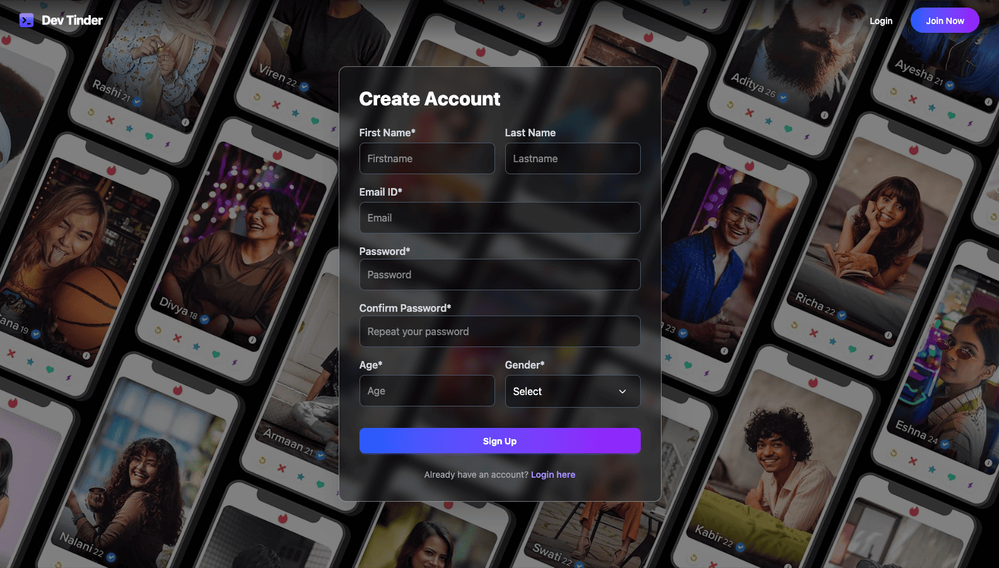 | 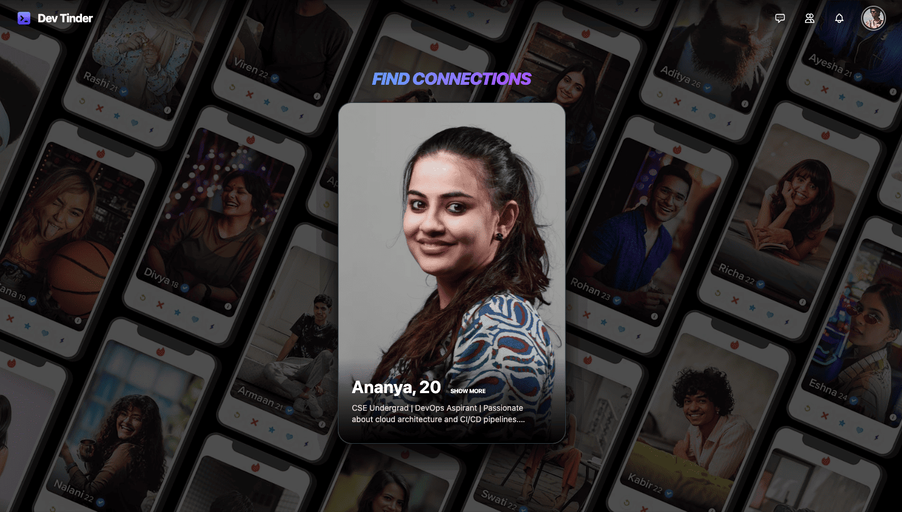 |
| **5. Connection Requests** | **6. Connections List** |
| 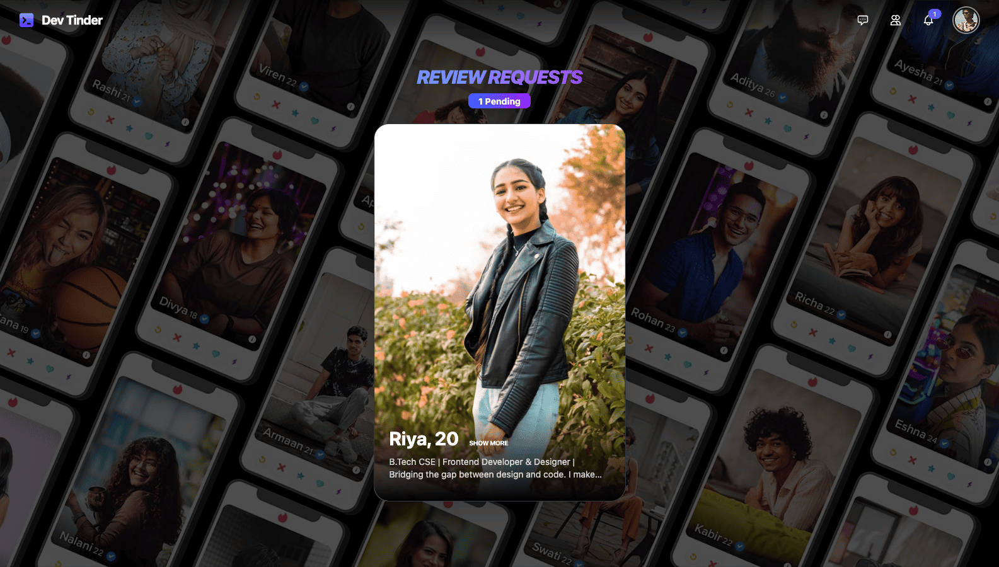 | 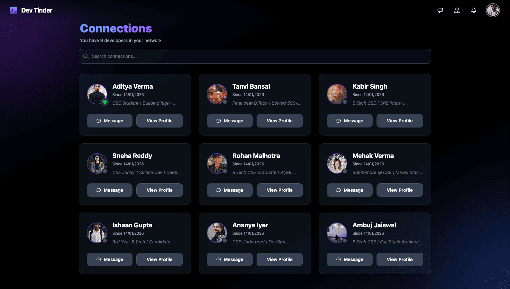 |
| **7. Messages** | **8. Real-Time Chat** |
| 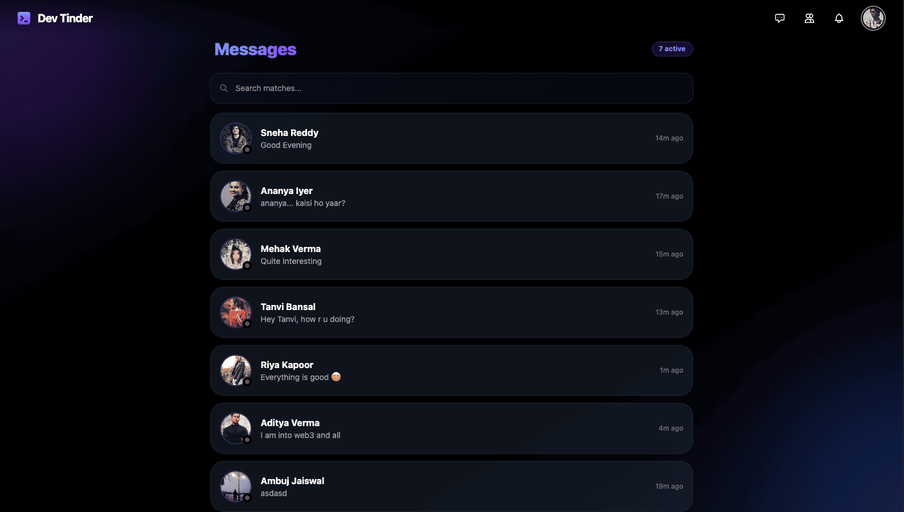 | 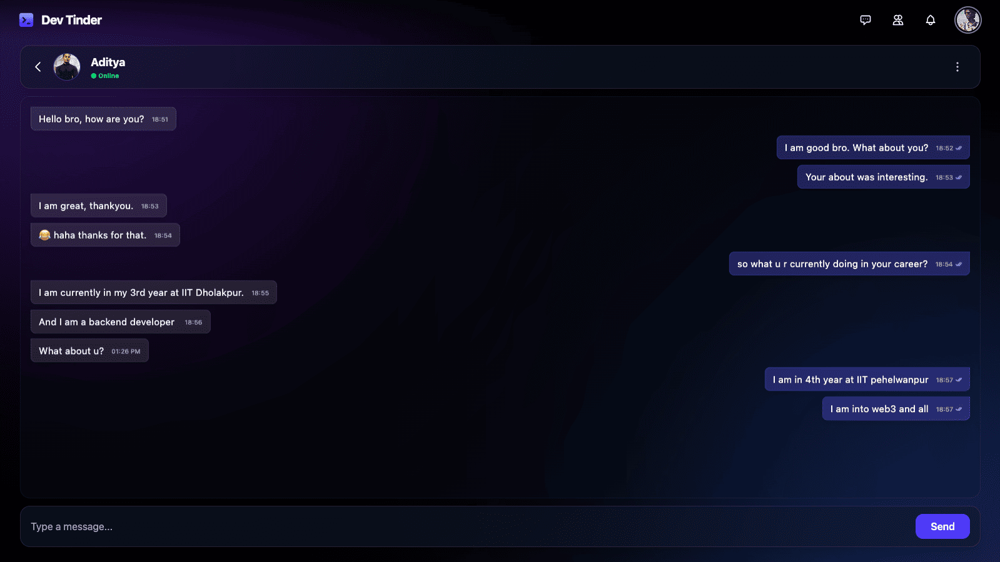 |
| **9. Edit Profile** | **10. Buy Premium** |
| 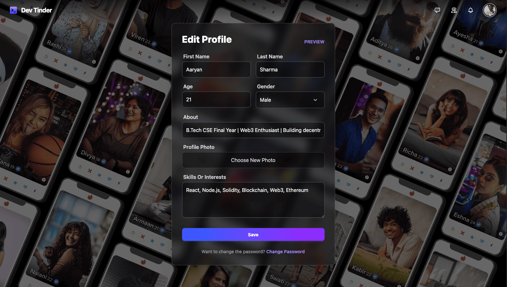 | 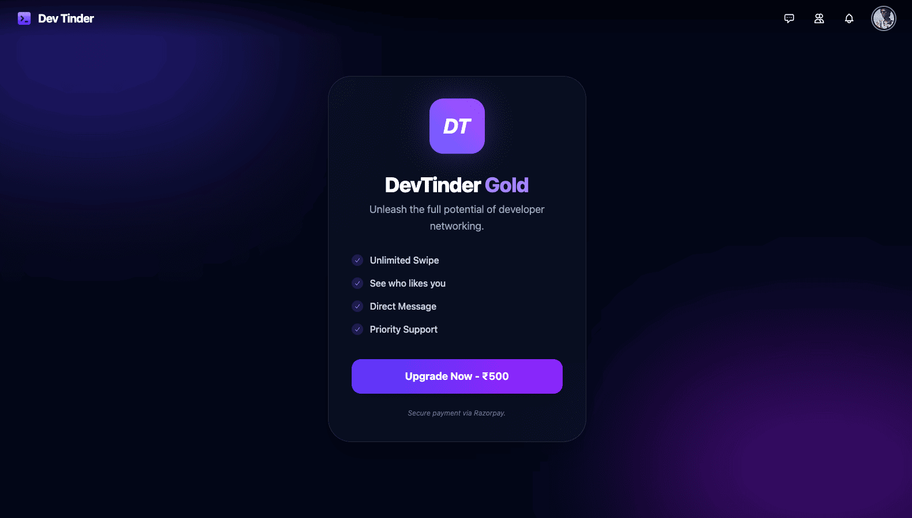 |

---

## 🏗 System Architecture

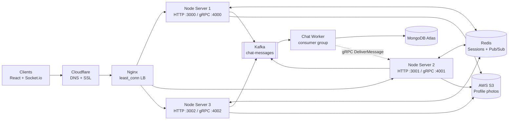

### How a chat message flows across servers
1. **User A** (connected to Server 1) emits `sendMessage` over Socket.io.
2. Server 1 publishes the message to the Kafka topic **`chat-messages`**, keyed by sender so per-user ordering is preserved.
3. A **Chat Worker** in the `chat-worker-group` consumer group picks it up (each message is processed exactly once across instances) and **persists it to MongoDB**.
4. The worker looks up **User B's session in Redis** (`session:<userId>` → `socketId` + `grpcAddress`) to find which server B is connected to.
5. It calls **`DeliverMessage` over gRPC** on that server, which pushes the message to B's socket. If B is offline, the message is already safe in MongoDB and shows up when B reconnects.

### Presence (online / offline)
Presence uses **Redis Pub/Sub** (`presenceEvents` channel) rather than Kafka: it is instantaneous and does not suffer from consumer-group rebalancing delays. Each server publishes small **delta events** (`userId`, `isOnline`) instead of re-broadcasting the full online-user list on every change.

### gRPC service (`chat.proto`)
| RPC | Purpose |
| :--- | :--- |
| `DeliverMessage` | Deliver a chat message to a socket on another server |
| `DeliverSeenUpdate` | Propagate read receipts |
| `DeliverTypingIndicator` | Propagate typing indicators |
| `DeliverNotification` | Push live notifications (badges) |

---

## 🛠 Tech Stack & Libraries

### Frontend
- **React.js + Vite:** Component-based UI with fast tooling.
- **Redux Toolkit:** State management (User, Feed, Chat, Requests).
- **Tailwind CSS & DaisyUI:** Styling.
- **Socket.io-client:** Real-time bi-directional communication.
- **Axios:** HTTP client.

### Backend (Node.js)
- **Core:** `express`, `dotenv`, `cross-env`, `cors`, `cookie-parser`.
- **Database:** `mongoose` (MongoDB Atlas).
- **Auth & Security:** `jsonwebtoken` (JWT in HTTP-only cookies), `bcrypt`, `validator`.
- **Real-Time:** `socket.io`.
- **Distributed Systems:**
  - `ioredis`: centralized session store + Pub/Sub presence.
  - `@grpc/grpc-js`, `@grpc/proto-loader`: inter-server message routing.
  - `kafkajs`: durable chat pipeline with consumer groups.
- **File Storage:** `@aws-sdk/client-s3`, `multer`, `multer-s3` (profile photos on AWS S3, jpg/png, 5MB limit).
- **Payments:** `razorpay` (orders + webhook verification).
- **Email & Jobs:** `resend` (email API), `bull` (Redis-backed job queue), `node-cron` (weekly digest job).

### Infrastructure & Deployment
- **Load Balancer / Reverse Proxy:** **Nginx** (`least_conn`, WebSocket upgrade for Socket.io).
- **Compute:** **AWS EC2** (Ubuntu).
- **Process Manager:** **PM2**.
- **DNS, CDN & SSL:** **Cloudflare**.
- **Storage:** **AWS S3**.
- **Database:** MongoDB Atlas.

---

## ✨ Key Features

### 1. Authentication & Profile
- JWT authentication with HTTP-only cookies.
- Edit bio, skills, age, and gender, and upload profile pictures directly to **AWS S3**.
- Strict server-side validation using `validator.js`.

### 2. Connection Feed
- Mark profiles as **Interested** or **Ignored**.
- Feed only shows users you haven't interacted with yet.
- View, accept, or reject incoming connection requests.

### 3. Real-Time Chat & Presence (multi-server)
- Messages work even when sender and receiver are connected to **different servers** (Redis session lookup + gRPC routing).
- **Durable delivery:** every message goes through Kafka and is persisted before delivery, so nothing is lost if a user is offline or a server restarts.
- Live online/offline dots, typing indicators, read receipts, and notification badges.

### 4. Premium Membership
- **Razorpay** Silver / Gold plans.
- Flow: Create Order → Payment → Webhook verification → membership upgrade.

### 5. Background Jobs
- **Bull** queue (Redis) offloads email sending from the request thread.
- **Resend** sends the emails; **node-cron** schedules the weekly digest.
- The email jobs are currently switched off in production (the cron import and send calls are commented out).

---

## ⚙️ Running Locally (multi-server setup)

**Prerequisites:** Node.js 18+, MongoDB, Redis, Kafka (`localhost:9092`), Nginx.

```bash
# 1. Install
cd Backend && npm install
cd ../Frontend && npm install

# 2. Start infra
brew services start redis
# start Kafka (KAFKA_BROKERS defaults to localhost:9092)

# 3. Start 3 backend instances (separate terminals)
cd Backend
HTTP_PORT=3000 GRPC_PORT=4000 npm run dev
HTTP_PORT=3001 GRPC_PORT=4001 npm run dev
HTTP_PORT=3002 GRPC_PORT=4002 npm run dev

# 4. Start the Nginx load balancer on :8080
nginx -c "$(pwd)/nginx.conf"

# 5. Start the frontend
cd ../Frontend && npm run dev
```

### Environment variables (`Backend/.env`)
```
MONGO_URI=
JWT_SECRET=
RAZORPAY_KEY_ID=
RAZORPAY_KEY_SECRET=
RAZORPAY_WEBHOOK_SECRET=
AWS_S3_BUCKET=
AWS_REGION=
AWS_S3_ACCESS_KEY=
AWS_S3_SECRET_KEY=
RESEND_API_KEY=
EMAIL_FROM=
KAFKA_BROKERS=localhost:9092
```

### One-time scripts
- `node migrate.js`: moves embedded chat messages into the separate `messages` collection.
- `node migrateImagesToS3.js [--dry-run]`: copies existing profile photos to S3 and updates `photoURL` in MongoDB.

---

## 🌐 Deployment Flow

1. A request hits `https://devtinder.iambuzzdev.in`.
2. **Cloudflare** resolves DNS and terminates SSL.
3. Traffic reaches the **AWS EC2** instance.
4. **Nginx** load-balances HTTP and WebSocket traffic across the Node.js instances.
5. **PM2** keeps every instance alive and restarts it on failure.

---

## 🌿 Branches
- `main`: original single-server version.
- `feature/scaled-monolith`: horizontally scaled monolith (this README).
- `feature/true-microservices`: work in progress splitting into `core-api`, `chat-ws`, `presence-router` services.
